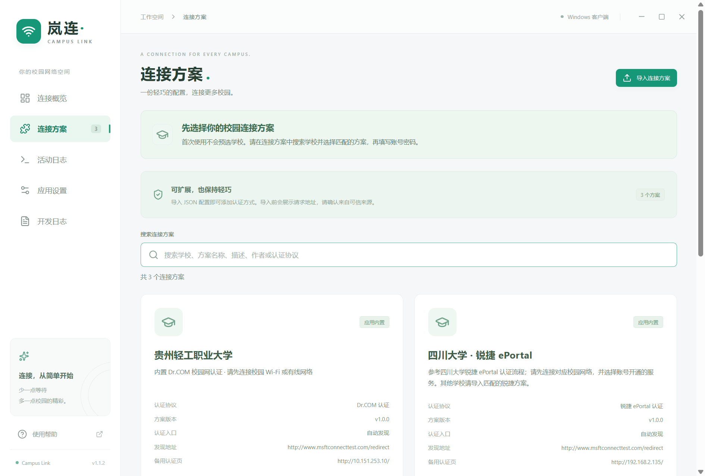

<div align="center">


# 岚连 Campus Link

**简单连接，自在校园。**

面向 Windows 和 macOS 的轻巧校园网认证工具，让连接、守护与方案管理更省心。

[](https://github.com/65658dsf/CampusLink/releases/latest)
[](https://github.com/65658dsf/CampusLink/releases)
[](https://github.com/65658dsf/CampusLink/actions/workflows/release.yml)
[](https://github.com/65658dsf/CampusLink/stargazers)

[**📥 下载客户端**](https://github.com/65658dsf/CampusLink/releases/latest) · [**📖 在线文档**](https://campuslink.xzncraft.cn/) · [**💬 反馈问题**](https://github.com/65658dsf/CampusLink/issues)

开发者：**[NingMeng123](https://github.com/65658dsf)**

</div>

## ✨ 连接校园，少一点折腾

| | 能做什么 |
| --- | --- |
| 🔌 轻松认证 | 支持 Dr.COM Web / ePortal、锐捷 ePortal Web 和声明式 HTTP 方案；内置方案自动发现认证入口 |
| 🛡️ 网络守护 | 检测状态、断线重连、网络变化快速检查，托盘一键暂停或恢复 |
| 🧩 灵活配置 | 搜索学校方案，导入 / 导出 JSON，扩展更多校园网络 |
| 🔐 本地凭据 | 记住的密码通过系统加密保存，也支持仅在本次连接中使用 |
| 🖥️ 桌面常驻 | Windows / macOS 托盘、可选开机自启动、启动后自动连接与更新检查 |
| 🔎 方便排障 | 活动日志、服务器响应详情和脱敏诊断包导出 |

<p align="center">
  
</p>

## 🚀 三步开始

1. **安装客户端**：从 [Releases](https://github.com/65658dsf/CampusLink/releases/latest) 下载 Windows x64、Intel Mac 或 Apple Silicon 对应安装包。
2. **选择学校方案**：先连接校园 Wi-Fi 或网线，再到“连接方案”搜索学校。首次打开不会预选方案。
3. **填写账号并连接**：已认证时会直接展示在线状态；需要认证时输入账号密码，按需开启记住密码和自动连接。

内置 **贵州轻工职业大学（Dr.COM）**、**四川大学**、**成都理工大学（宜宾校区）**、**景德镇陶瓷大学（Dr.COM ePortal）** 方案；其他学校可[制作并导入 JSON](docs/plugin-guide.md)。景德镇陶瓷大学当前仅实现参考脚本的原始学号路径；实际门户有运营商下拉框，选项值与账号后缀映射尚待抓包核验，尚不宣称支持所有运营商，详见[接入说明](docs/jdztc-guide.md)。锐捷支持范围为 ePortal 网页认证。

> macOS 将应用拖入“应用程序”后运行。当前安装包未签名，macOS 也未公证，系统可能提示拦截；详见[安装说明](docs/usage.md#安装和首次连接)。

## 📚 想了解更多

[完整使用指南](docs/usage.md) · [方案制作](docs/plugin-guide.md) · [锐捷教程](docs/ruijie-guide.md) · [景陶接入](docs/jdztc-guide.md) · [版本更新](docs/releases-v1.1.3.md) · [构建与发布](docs/releases.md)

连接失败时先查看应用内日志，也可携带脱敏诊断信息提交 [Issue](https://github.com/65658dsf/CampusLink/issues)。学校账号、欠费或设备上限问题请联系校园网服务渠道。

## 🛠️ 本地开发

需要 **Node.js 22.12+** 和 npm。

```bash
npm ci
npm run dev
```

`npm run dev:web` 预览界面；`npm test` 运行测试；`npm run build` 检查类型并构建。更多命令见[使用指南](docs/usage.md#本地开发)。文档网站源码独立维护于 [CampusLinkPages](https://github.com/65658dsf/CampusLinkPages)。

## ⭐ Star History

如果岚连帮到了你，欢迎点亮一颗 Star，让更多同学发现它。

<a href="https://www.star-history.com/?repos=65658dsf%2FCampusLink&amp;type=date">
  <picture>
    <source media="(prefers-color-scheme: dark)" srcset="https://api.star-history.com/svg?repos=65658dsf/CampusLink&amp;type=Date&amp;theme=dark" />
    <source media="(prefers-color-scheme: light)" srcset="https://api.star-history.com/svg?repos=65658dsf/CampusLink&amp;type=Date" />
    
  </picture>
</a>

## ❤️ 感谢贡献者

感谢每一位提交代码、完善文档、反馈问题与分享校园方案的朋友。

<a href="https://github.com/65658dsf/CampusLink/graphs/contributors">
  
</a>

<sub>头像由 <a href="https://contrib.rocks">contrib.rocks</a> 根据 GitHub 贡献记录自动更新，点击可查看完整列表。</sub>

---

岚连是独立校园网辅助工具，与学校或认证服务商无官方隶属关系。使用外部方案前请核对认证地址；[隐私说明](docs/usage.md#密码与本地数据) · [第三方声明](assets/licenses/README.md)。
